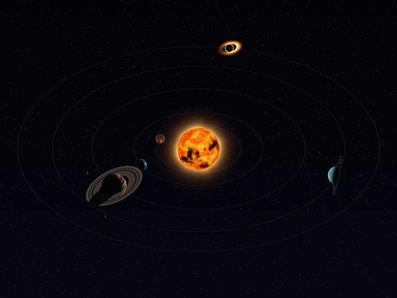
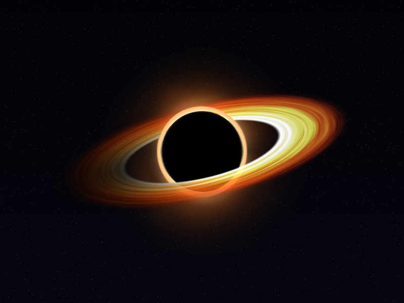
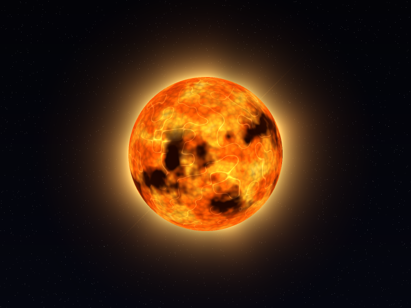
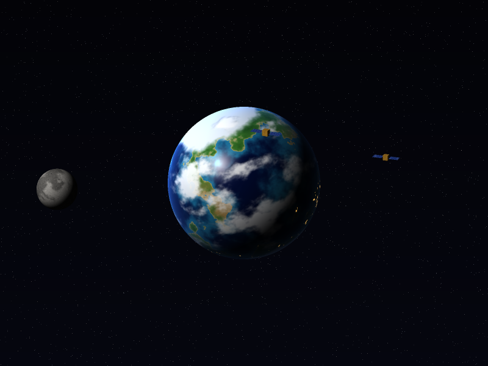
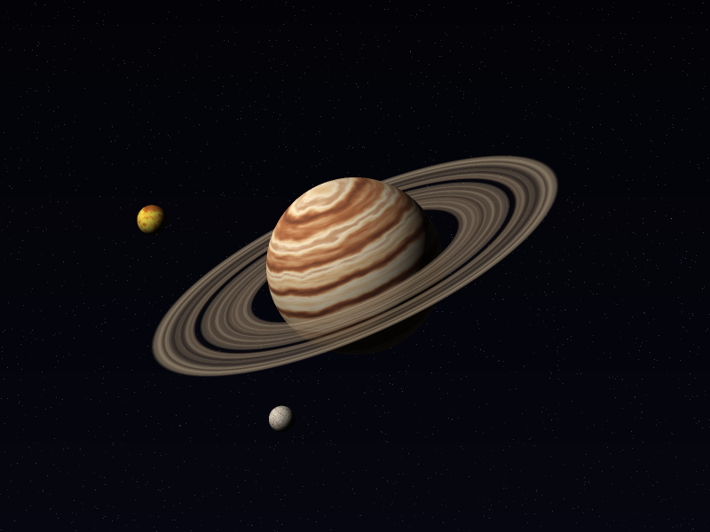
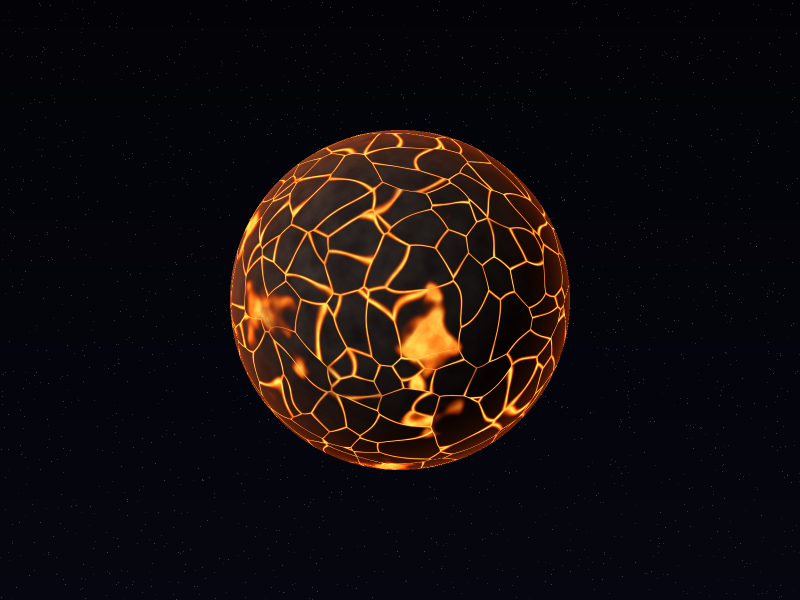
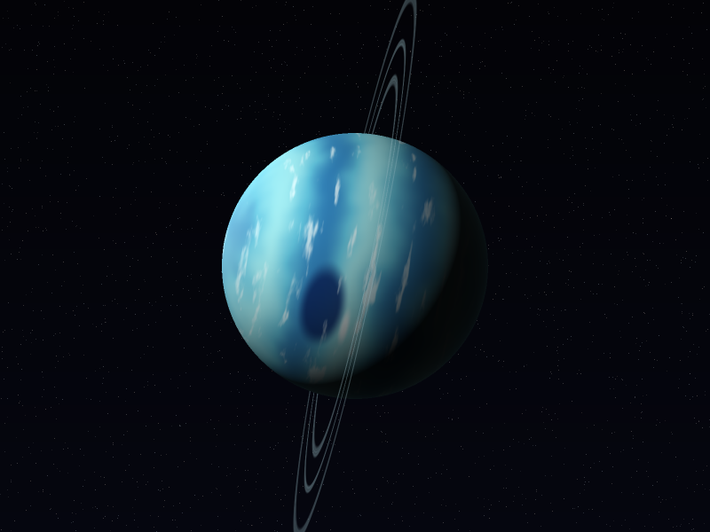

# Lab 5 – Shaders

Software renderer en Rust (rasterizador propio con z-buffer, sin texturas ni materiales) que dibuja cuerpos celestes **solo con shaders procedurales**: ruido de valor, fBm, ruido celular (Worley), domain warping y rampas de color. La esfera, los anillos y la corona se generan por código.

## Ejecutar

```
cargo run --release              # ventana interactiva
cargo run --release -- --save-all   # genera los PNG de docs/ (con supermuestreo 2x)
```

Controles: `1`–`6` cambia de cuerpo, `7` muestra el **sistema completo** (vista inicial) · flechas rotan la cámara · rueda del ratón o `+`/`-` hacen zoom · `Tab` (en el sistema) enfoca y sigue al siguiente cuerpo: estrella → lava → rocoso → gaseoso → hielo → agujero negro · `R` reinicia la vista · `Espacio` pausa la animación · `S` guarda un PNG · `Esc` sale.

## Cuerpos

| # | Cuerpo | Capas del shader |
|---|--------|------------------|
| 1 | **Estrella** | convección (fBm con warp animado) · gránulos (Worley) · manchas solares · fulguraciones (ruido ridged) · limbo oscurecido + halo; corona como billboard separado con rayos animados |
| 2 | **Planeta rocoso (tipo Tierra) + luna** | relieve océano/continente · desiertos por latitud · casquetes polares · nubes animadas con sombra · luces de ciudades en el lado nocturno · atmósfera (fresnel) · brillo especular en el agua |
| 3 | **Gigante gaseoso + anillos** | bandas con turbulencia · vetas con rotación diferencial · gran tormenta con remolino · sombra de los anillos sobre el planeta · bruma atmosférica |
| 4 | **Planeta de lava** (extra) | corteza de basalto · grietas de magma pulsantes (Worley) · mares de magma · humo · atmósfera incandescente |
| 5 | **Gigante de hielo** (extra) | bandas de metano · gran mancha oscura + nube compañera · cirros · casquete polar · anillos finos; eje inclinado como Urano |
| 6 | **Agujero negro** (extra) | horizonte negro con anillo de fotones · resplandor lenteado (más fuerte arriba y abajo) · disco de acreción con rotación diferencial y vetas · efecto Doppler (lado que se acerca más brillante) |

Extras: **satélites artificiales** (malla separada: cuerpo dorado y paneles solares con celdas) orbitando la Tierra; **lunas** del gaseoso (Ío con volcanes, Europa con grietas); **anillos** (malla de anillo separada, semitransparente, con división de Cassini y sombra del planeta) en el gaseoso y el de hielo; **luna** (esfera separada con cráteres de dos escalas y mares) que orbita la Tierra; **rotación y traslación** (cada planeta gira sobre su eje inclinado y la luna orbita).

## Capturas

### Sistema completo
La estrella al centro y los demás cuerpos orbitándola (traslación), cada uno iluminado desde la estrella.



### Agujero negro


### Estrella


### Planeta rocoso con luna y satélites


### Gigante gaseoso con anillos


### Planeta de lava


### Gigante de hielo


## Estructura

- `src/shaders.rs` – todos los shaders de fragmento.
- `src/noise.rs` – ruido de valor, fBm y Worley.
- `src/raster.rs` – rasterizador de triángulos con z-buffer y mezcla alfa.
- `src/mesh.rs` – esfera, anillo y quad generados proceduralmente.
- `src/main.rs` – escena, animación, ventana y captura de PNG.
